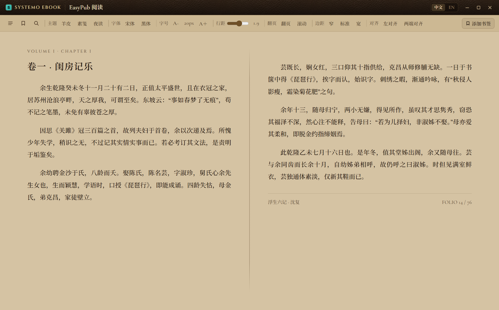

> **项目介绍页（HTML Blog）：[https://systemsssx.github.io/systemo-ebook/](https://systemsssx.github.io/systemo-ebook/)**
>
> **[简体中文](README.md) | [English](README_EN.md) | [下载安装包](https://github.com/systemsssx/systemo-ebook/releases/tag/v2.0.0) | [更新日志](CHANGELOG.md)**

# systemo ebook

Windows 本地电子书工具，用于在电脑上找书、整理 TXT、生成 EPUB，并将书传往阅读设备或留在桌面端阅读。

[](https://github.com/systemsssx/systemo-ebook/releases)
[](https://github.com/systemsssx/systemo-ebook/releases/tag/v2.0.0)
[](https://systemsssx.github.io/systemo-ebook/)
[](https://github.com/systemsssx/systemo-ebook/stargazers)


**项目定位：** 把网文和本地 TXT 整理成带目录与封面的标准 EPUB，再送到常用的手机、Kindle 或平板，整个处理过程在本地完成，尽量减少来回换软件和反复重排的麻烦。

---

## 一本书是怎么处理的

`找书或导入 TXT` → `识别章节与配封面` → `生成 EPUB` → `发往阅读设备` → `留在书库与桌面阅读`

- **找书或导入**：输入书名（或 `书名@作者`）从多个书源检索正文与轻小说分卷，也可以在推荐榜单里挑选，或者直接把本地 TXT 拖进窗口。
- **分章与封面**：按常见的卷、章、节规则切分目录，可以在列表里手动增删章节并预览；联网查询作者与候选封面，比对同图后选分辨率更高的原图，再由本地模型放大清晰度。
- **打包成书**：把正文、目录、作者信息和封面合成标准 EPUB，转换结束后自动清空临时下载目录。
- **传往设备**：根据手头的设备，在本地云盘目录、局域网 WiFi、Send to Kindle 或百度网盘中转里选一条通道发出。
- **入库与阅读**：生成好的书留在本地书库里，更换导出目录也不会丢记录；在书库里双击可以直接用内置阅读器打开。

---

## 几个主要部分的做法

### 获取文本、分章与封面
- **下载分流**：同时接了普通高速源和精校源；轻小说按榜单分页浏览，点击卡片即可在原位置展开分卷勾选，下载过程随时可以取消。
- **TXT 分章校验**：如果本地 TXT 的标题格式不够规范，识别后可以在章节列表里删掉误切项或补加章节，确认后再打包。
- **封面选优与本地放大**：跨来源比对同一张封面并优先取高分辨率原图，清晰度增强走打包在本地的模型，不依赖外部付费接口。

### 把书传到手机、平板和 Kindle
- **本地云盘目录**：自动查找电脑上的 iCloud Drive、OneDrive 或 Google Drive 同步文件夹，把 EPUB 写进其中的 `EasyPub` 子目录，交给系统云盘同步到苹果或其他设备。
- **局域网 WiFi**：手机和电脑连在同一 WiFi 下，通过本机浏览器配合局域网地址把书传到手机，浏览器驱动版本会在后台自动匹配更新。
- **Send to Kindle**：走 Amazon 官方网页通道发送，登录态只保存在本机会话目录里，不记录密码。
- **百度网盘中转**：仍习惯经百度网盘传给苹果图书时，授权会直接拉起本机 Chrome 或 Edge 的独立空白会话登录，避免内置窗口被拦截。

### 书库、阅读器与界面形态
- **本地书库**：成书记录跨导出目录持久保留，支持多选批量发送、导出或删除；传输队列直接显示 EPUB 里嵌入的封面图。
- **内置阅读器**：基于 `foliate-js`，提供目录、书签、全文检索，可调字号、行距、边距以及翻页或滚动模式，内置羊皮、素笺和夜读三套配色。
- **窗口布局**：平时以单页显示；宽屏下可以把顶栏页签拖成左右双页分屏（例如左边制作、右边传输），顶栏也提供纯纸背景和中英切换。

---

## 界面实景

| 下载与多源检索 | 导入 TXT、分章与封面预览 |
| :---: | :---: |
|  |  |
| **四条传输通道与待发队列** | **本地书库** |
|  |  |
| **顶栏拖拽左右分屏** | **连续执行页面** |
|  |  |
| **内置阅读器（羊皮配色）** | **内置阅读器（夜读配色）** |
|  |  |

---

## 数据与使用边界

- **本地处理**：文本清洗、分章、封面放大与书库管理都在本机完成；公开源码与发行包均不含个人设置、书库记录、Cookie 或私有代理节点。
- **账号与网络**：Kindle 通道需登录自己的 Amazon 账号，百度网盘中转需本机浏览器授权，WiFi 直传要求手机和电脑处于同一局域网；不希望绑定网盘时可直接用本地云盘目录或 WiFi。
- **内置代理说明**：代理内核默认关闭并会自动避让系统已有代理；公开版本不含私有订阅地址，需要访问受限站点时可沿用系统代理，或自行通过环境变量 `EASYPUB_PROXY_SUB_URL` 接入。

---

## 获取与运行

### 直接使用完整包（Windows 10 / 11 x64）
1. 前往 [Releases](https://github.com/systemsssx/systemo-ebook/releases/tag/v2.0.0) 下载 `systemo-ebook-v2.0.0-full.rar`（`275,575,368` 字节 / `262.8 MiB`，解压后 `335` 个文件 / `901.3 MB`）。
2. 解压到可写目录（如 `D:\systemo-ebook`，不要放在 `C:\Program Files`），保留整个文件夹。
3. 双击 `EasyPub.exe` 启动；发布包已带齐后端、Pandoc、字体与本地超分模型，首次打开书库为空属正常现象。

SHA256：`A687ECB5E659A6088B92398E33895B9CD0899F8E1666DF5A7E65D4AB9D69272A`

### 从源码运行与修改书源
环境需要 Windows 10 / 11 x64、Node.js 18+、Python 3.11+ 与 Electron 27：

```powershell
pip install -r requirements.txt
npm install
npm start
```

- 书源与榜单解析位于 `novelmeta/`（元数据与封面）、`novel_dl.py`（网文下载）、`rank_pool.py`（推荐榜单）和 `linovelib.py`（轻小说分卷），可按需要增改。
- 修改前端样式或脚本后执行 `npm run bump` 更新缓存戳；大体积运行资源（`fonts/`、`models/`、`pandoc-3.10.2/`、`chromedriver.exe`、`tools/mihomo/`）随 Release 包提供，不放在 Git 仓库中。

### 当前版本说明
目前只维护完整版单线发布，最新版本为 **v2.0.0**（2026-11-23）：界面换成了羊皮卷 V3 风格并支持顶栏拖拽双页分屏；补上了本地云盘同步通道；百度网盘授权改为唤起本机 Chrome 或 Edge 空白会话，WiFi 与封面通道改为自动热更浏览器驱动；封面查找加入多源同图高清比对。历史变更见 [CHANGELOG.md](CHANGELOG.md)。

---

## 免责声明与致谢

- 用爱发电：这是一个纯粹为了“让自己看书更爽”而写出来的个人折腾项目，仅供编程学习与技术研究，完全无任何商业盈利行为（不卖课、不收费、无广告）。
- 技术本质：项目中的网文/轻小说下载与封面搜刮功能，本质上是对公开网络信息的个人离线缓存与自动化重排（相当于用代码替你完成了“打开网页 ➔ 摘录文字 ➔ 加上封面排成EPUB”的机械劳动），旨在解决多设备阅读的排版与传输痛点，并非为了建立盗版分发平台。
- 版权倡导：好故事值得被温柔对待，更值得被付费支持。本工具生成的电子书仅限个人离线自用与护眼设备转码，严禁用于任何形式的二次分发、传播或商业牟利。看书遇到喜欢的作品，请一定去正版平台订阅支持原作者！

项目基于 [Electron](https://www.electronjs.org/)、[foliate-js](https://github.com/johnfactotum/foliate-js)、[@readium/css](https://github.com/readium/css)、[Pandoc](https://pandoc.org/)、[OpenCC](https://github.com/BYVoid/OpenCC) 和 [PyInstaller](https://pyinstaller.org/) 构建。代码仅供学习交流，**All rights reserved**。
