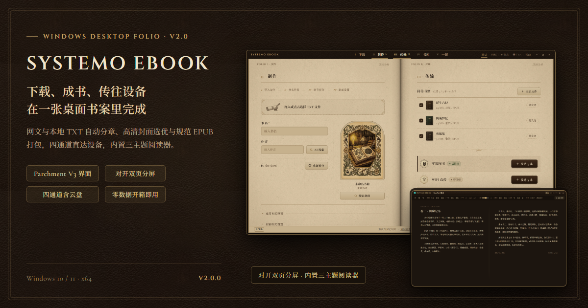
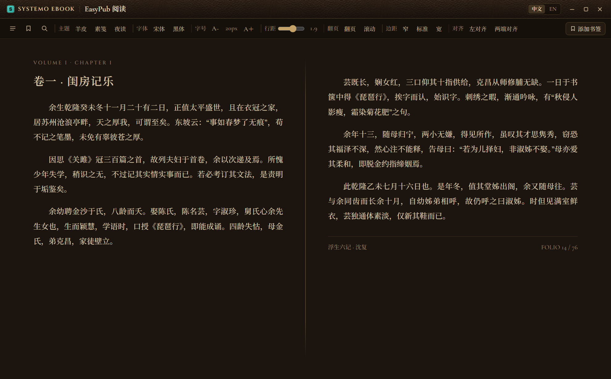

> **专题介绍页（HTML Blog）：[https://systemsssx.github.io/systemo-ebook/](https://systemsssx.github.io/systemo-ebook/)**
>
> **[简体中文](README.md) | [English](README_EN.md) | [下载 v2.0.0 安装包](https://github.com/systemsssx/systemo-ebook/releases/tag/v2.0.0) | [更新日志](CHANGELOG.md)**

# systemo ebook

**Windows 本地电子书工作台 — 下载 · 制作 · 四通道传输 · 本地阅读**

项目定位：把网文与本地 TXT 整理成规范 EPUB 并送到常用阅读设备，全程在本地完成，尽量减少多端倒腾与排版返工的负担。

[](https://github.com/systemsssx/systemo-ebook/releases)
[](https://github.com/systemsssx/systemo-ebook/releases/tag/v2.0.0)
[](https://systemsssx.github.io/systemo-ebook/)
[](https://github.com/systemsssx/systemo-ebook/stargazers)



---

## 核心任务闭环

`搜索或导入` → `分章与高清封面` → `打包 EPUB` → `四通道送达设备` → `入库与桌面直读`

---

## 核心功能

| 模块 | 主要能力 | 实际处理方式 |
| :--- | :--- | :--- |
| **下载与推荐** | 多源检索、综合榜单与轻小说选卷 | 聚合微信读书、起点、番茄、晋江每批 14 本推荐；轻小说 5 榜分页并支持卡片原地展开选卷。 |
| **制作与封面** | TXT 智能分章与高清封面增强 | 自动识别卷章目录，多源同图分辨率比对优选原图，配合本地离线模型完成清晰度超分。 |
| **四通道传输** | 覆盖主流阅读设备的本地送达 | 支持苹果图书（百度网盘中转）、WiFi 局域网直传、Send to Kindle 与新增本地云盘同步。 |
| **书库与队列** | 跨目录持久化与自动清理 | 书库历史跨导出目录持久保留，转码完成后自动清空临时下载目录，传输列队直显内嵌封面。 |
| **内置阅读器** | 桌面端双栏护眼直读 | 基于 `foliate-js` 提供羊皮、素笺、夜读 3 套主题，支持目录跳转、书签、全文检索与进度保存。 |
| **双页工作台** | 一键流水线与对开双页分屏 | 支持下载、转码、传书连贯执行；顶栏页签可拖成左右对开双页分屏，支持纯纸模式与中英双语。 |

---

## 界面实景（Parchment V3）

| I · 下载与多源检索 | II · 制作与拱券封面槽 |
| :---: | :---: |
|  |  |
| **III · 四通道传输（含本地云盘同步）** | **IV · 本地精装书库** |
|  |  |
| **天头拖拽对开双页分屏** | **V · 一键流水线** |
|  |  |
| **内置阅读器 · 羊皮双栏主题** | **内置阅读器 · 胡桃夜读主题** |
|  |  |

---

## v2.0.0 重点变化

- **羊皮卷 V3 与对开双页分屏**：界面重做为 18 世纪西洋羊皮卷与古铜细线排印，支持顶栏页签拖拽左右分屏，并可随时切换纯纸视图与中英双语。
- **新增第 4 通道「云盘同步」**：无需经过第三方网盘中转，自动探测本机 iCloud Drive、OneDrive 或 Google Drive 目录，直接写入 `EasyPub` 子目录跨端同步。
- **百度原生浏览器授权与驱动热更**：百度授权改为唤起本机 Chrome 或 Edge 独立空白会话，根治状态栏转圈卡死；WiFi 直传与封面兜底支持浏览器驱动自动匹配热更。
- **高清封面选优与按需代理内核**：多源搜刮封面时自动比对同图高分辨率原图再做本地超分；内置代理内核默认关闭且自动避让系统代理，公开版不含私人订阅。

---

## 三分钟上手

1. 前往 [Releases](https://github.com/systemsssx/systemo-ebook/releases/tag/v2.0.0) 下载 `systemo-ebook-v2.0.0-full.rar`，解压到可写目录（如 `D:\systemo-ebook`，避免放进 `C:\Program Files`）。
2. 双击 `EasyPub.exe` 即可运行（已内置冻结后端、Pandoc、字体与离线超分模型，请整目录保留；首次打开书库为空属零数据包正常状态）。
3. 检索网文或拖入本地 TXT，生成带封面 EPUB 后通过任一通道传往设备，或在书库中双击直读。

**发行包校验（v2.0.0 / 构建戳 `1123205248` / 2026-11-23）**

- 文件：`systemo-ebook-v2.0.0-full.rar`
- 大小：`275,575,368` 字节（`262.8 MiB`），解压后 `335` 文件 / `901.3 MB`
- SHA256：`A687ECB5E659A6088B92398E33895B9CD0899F8E1666DF5A7E65D4AB9D69272A`

---

## 开发者从源码运行与自定义书源

本项目仅维护完整版单线发布（原精简版分支已停止维护），全部源码开放供个人学习与书源扩展。

| 环境项 | 版本要求 | 说明 |
| :--- | :--- | :--- |
| Windows | Windows 10 / 11 x64 | 桌面运行与本机浏览器联动环境 |
| Node.js | 18+（Electron `^27.3.0`） | 桌面壳与界面运行 |
| Python | 3.11+ | 下载、分章、封面优选与传输脚本 |
| Chrome / Edge | 稳定版 | 百度原生会话授权、WiFi 直传与封面兜底 |

```powershell
git clone https://github.com/systemsssx/systemo-ebook.git
cd systemo-ebook
pip install -r requirements.txt
npm install
npm start
```

- **自定义书源**：解析与榜单逻辑位于 `novelmeta/`、`novel_dl.py`、`rank_pool.py`、`linovelib.py`，可按站点结构增改；修改前端样式或脚本后运行 `npm run bump` 刷新缓存戳。
- **大文件说明**：`fonts/`、`models/`、`pandoc-3.10.2/`、`chromedriver.exe` 与 `tools/mihomo/` 均已内置于 Release 压缩包，源码仓库不含大体积二进制。
- **自有代理订阅**：公开源码与公开包均不含私人订阅链接；如需访问受限站点，可直接使用本机系统代理，或设置环境变量 `EASYPUB_PROXY_SUB_URL` 接入自有订阅。

---

## 数据隐私与免责声明

**隐私边界**

- 源码仓库与公开安装包均为零数据状态，不含个人配置、书库记录、Cookie 或预置代理节点。
- Kindle 传输需登录自己的 Amazon 账号，苹果图书中转需在本地浏览器授权百度网盘，WiFi 直传仅在局域网内通信；不愿绑定网盘时，建议直接使用本地云盘同步或 WiFi 直传。

**免责声明**

- 用爱发电：这是一个纯粹为了“让自己看书更爽”而写出来的个人折腾项目，仅供编程学习与技术研究，完全无任何商业盈利行为（不卖课、不收费、无广告）。
- 技术本质：项目中的网文/轻小说下载与封面搜刮功能，本质上是对公开网络信息的个人离线缓存与自动化重排（相当于用代码替你完成了“打开网页 ➔ 摘录文字 ➔ 加上封面排成EPUB”的机械劳动），旨在解决多设备阅读的排版与传输痛点，并非为了建立盗版分发平台。
- 版权倡导：好故事值得被温柔对待，更值得被付费支持。本工具生成的电子书仅限个人离线自用与护眼设备转码，严禁用于任何形式的二次分发、传播或商业牟利。看书遇到喜欢的作品，请一定去正版平台订阅支持原作者！

---

## 致谢与许可

- 基于 [Electron](https://www.electronjs.org/)、[foliate-js](https://github.com/johnfactotum/foliate-js)、[@readium/css](https://github.com/readium/css)、[Pandoc](https://pandoc.org/)、[OpenCC](https://github.com/BYVoid/OpenCC) 与 [PyInstaller](https://pyinstaller.org/) 构建。
- 本项目源码仅供学习交流，**All rights reserved**；第三方组件许可归各自项目所有。如果本项目对你的日常阅读有帮助，欢迎点一颗 Star。
