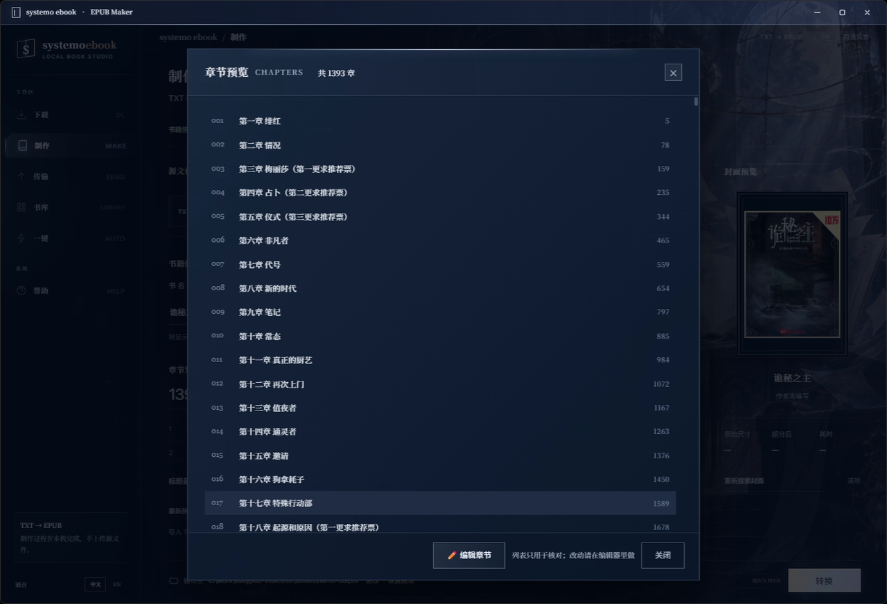
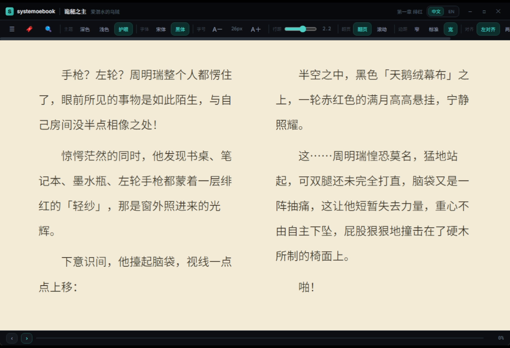

<div align="center">


# systemo ebook

**A Windows ebook workshop — Download · Make · Transfer · Read · Discover**

From a title to a cover-ready EPUB you can read on your phone, Kindle or Apple Books — **all processed locally, nothing uploaded.**


[](https://github.com/systemsssx/systemo-ebook/stargazers)

</div>

**[简体中文](README.md) | English**

> **This repository contains the source code and docs of the full v1.1.0 release.** Download, make, transfer, read and discovery are all enabled.
> The ready-to-run installer is on the [Releases](../../releases) page (Windows 10/11 x64 — extract and run, no Python/Node required).
> ⭐ **If this project saves you time, please consider giving it a Star** — it is the most direct support for a personal project.

---

## 🚀 Quick start

1. Open [Releases](../../releases) and download `systemo-ebook-v1.1.0-full.rar`;
2. Extract it to a **writable folder** (e.g. `D:\systemo ebook`, not `C:\Program Files`);
3. Double-click `EasyPub.exe`. The first launch takes a few extra seconds (backend warm-up) — that is normal.

> The release bundle already contains the frozen Python backend (PyInstaller), ChromeDriver, Pandoc, fonts and the cover-enhancement model.
> Please extract / move the **whole folder** — do not take the exe alone.

---

## 🧭 What is it

Not a single-purpose utility, but a complete "ebook production line":
**download / import → auto chapter split → author & cover lookup → generate EPUB → transfer to device → library → built-in reader.**
It is a local desktop app: your data never leaves the machine. Built for the real pain of multi-device reading and re-layout.

| Module | What it does |
|---|---|
| ⬇️ **Download** | Enter a title or `title@author`, search across multiple sources (Biquge crawler / UU看書 proofread source / 久久 / Bilibili light-novel volume picker); real progress, cancel anytime |
| 📝 **Make** | TXT auto chapter split (volume / chapter / section; manual add-remove-edit, live preview) → online author lookup → cover search (small covers auto-upgraded) → EPUB with cover and TOC |
| 📤 **Transfer** | Three channels: ① Apple Books (via Baidu Netdisk relay) ② **Wi-Fi direct** (open the address on your phone) ③ **Send to Kindle** (official Amazon channel) |
| 📚 **Library** | Finished EPUBs are added automatically; double-click to read, right-click for details, multi-select for batch transfer / export / delete |
| 🧭 **Discover** | Multi-source rankings (WeRead / Qidian / Fanqie / Jinjiang / Bilibili light novels); 14 picks per batch for general recommendations, 5 boards with pagination for light novels |
| 📖 **Read** | Built-in **foliate-js** reader: TOC / bookmarks / full-text search / themes (dark · light · eye-care) / fonts / font size / line height / paginated & scrolled / margins / alignment |
| ⚡ **One-click** | Title → search → download → split → cover → convert → transfer, all in one pipeline |
| 🎛️ **UI** | One-click switch between illustrated moonlit background and a minimal background; Chinese & English UI; local-first workbench |

---

## 📸 Screenshots

| Download (multi-source search) | Pick a download source |
|---|---|
|  |  |

| Make (auto chapter split) | Chapter preview |
|---|---|
|  |  |

| Transfer (three channels) | Library |
|---|---|
|  |  |

| Discover (multi-source rankings, 14 per batch) | Light-novel boards (5 boards + pagination) |
|---|---|
|  |  |

| Built-in reader (eye-care, two columns) | One-click creation |
|---|---|
|  |  |

| English UI |
|---|
|  |

---

## 🏗 Architecture

```
┌──────────────────────────── Electron ────────────────────────────┐
│ Renderer (vanilla JS, no framework)                               │
│   index.html · library.js · i18n.js · settings-ui.js              │
│   resona-workspace / studio / layout / theme / bridge.css         │
│   background-switch.js (illustrated / minimal background)         │
│        │  window.electronAPI.* (preload.js / contextBridge)       │
│ Main process main.js                                              │
│   · windows & IPC  · three transfer channels  · sendqueue staging │
│   · forwards child-process stdout to the UI, writes logs\*.log    │
└───────────────────────────────┬──────────────────────────────────┘
                                │ spawn
        ┌───────────────────────┴────────────────────────┐
        │ dev:  python xxx.py                            │
        │ release: resources\backend\easypub-backend.exe │ ← PyInstaller
        └───────────────────────┬────────────────────────┘
                                │ stdout: @@INFO / @@PROGRESS / @@RESULT / @@RANK + JSON
┌───────────────────────────────┴──────────────────────────────────┐
│ Python backend                                                    │
│   novel_dl.py / xbiquzw.py / uukanshu.py  web-novel downloaders   │
│   epub_generator.py   TXT → chapters → EPUB with cover            │
│   meta_lookup.py + novelmeta/  author/cover lookup, rankings      │
│   linovelib.py        Bilibili light novels (volumes / images)    │
│   wifi_upload.py / get_auth_code.py / upload_folder_cmd.py        │
│   image_enhancer.py   local cover upscaling (ONNX, offline)       │
│   backend_entry.py    bundle entry point                          │
└──────────────────────────────────────────────────────────────────┘
```

**How the three transfer channels work**:

| Channel | Implementation |
|---|---|
| Apple Books | `bypy` uploads to Baidu Netdisk, then fetch it in Apple Books / Files on the phone |
| Wi-Fi direct | local HTTP server + `Selenium` driving Chrome to upload into the page opened on the phone (same LAN) |
| Send to Kindle | Amazon's official Send to Kindle web channel (login state only, password is never stored) |

**IPC protocol**: every Python stage prints one `@@MARKER {json}` line to stdout, the main process parses it and forwards to the UI
(`@@INFO` hints / `@@PROGRESS` progress / `@@RESULT` result / `@@RANK` ranking candidates).

---

## 🧰 Build from source

| Requirement | Version | Notes |
|---|---|---|
| **Node.js** | 18+ (tested on 20) | runs Electron |
| **Electron** | `^27.3.0` (devDependency) | desktop shell |
| **electron-builder** | `^24.0.0` (devDependency) | packaging |
| **Node deps** | `@readium/css` `foliate-js` | EPUB reading / layout |
| **Python** | **3.11+** | backend scripts |
| **Browser** | Google Chrome installed | Selenium drives it for Wi-Fi transfer / cover fallback |
| **ChromeDriver** | must match your Chrome major version | Wi-Fi transfer / auth automation |
| **Pandoc** | 3.10.2 (bundled in releases) | format conversion |

```powershell
pip install -r requirements.txt
npm install
npm start                              # development mode
npx electron-builder --win dir --x64   # unpacked build (output in dist\win-unpacked)
```

**Large files not included in the repo** (all bundled in the release; add them yourself if you build from source):

- `fonts/` (Noto Sans SC / Noto Serif SC / Inter, ~42 MB) — the UI falls back to system fonts when missing;
- `models/` (cover upscaling ONNX, ~4.6 MB) — upscaling degrades gracefully when missing;
- `chromedriver.exe` (~24 MB) and `pandoc-3.10.2/` — required by browser automation / conversion; bundled in the release.

> After changing CSS / JS, run `npm run bump` to refresh the `?v=` cache-busters in `index.html`, otherwise the UI may keep using cached files.

### 🧩 Custom book sources

The source code is open on purpose: **every book source and parsing rule is editable.** After downloading / cloning the source, you can add or modify your own sources:

- `novelmeta/` — source adapters (search, metadata, rankings, cover lookup);
- `novel_dl.py` — novel downloader and source priority / dispatch logic;
- `rank_pool.py` — recommendation pool (rankings aggregation, quotas);
- `linovelib.py` — Bilibili light-novel source (volumes / images / EPUB assembly).

Add a new source, adjust the parsing rules, or wire up your own ranking feed, then rebuild the backend (`backend.spec`) or run the scripts directly in development mode.

---

## 🔧 First-run setup

- **Apple Books channel**: authorize Baidu Netdisk once on the Transfer page (sign in via the opened browser, paste the auth code back);
- **Send to Kindle**: sign in to your Amazon account (login state is kept only in a local session partition; the password is never stored);
- **Wi-Fi direct**: phone and PC on the **same Wi-Fi**; follow the dialog and open the shown address on the phone;
- **Cover upscaling / file names**: output directory and related options are at the bottom of the Make page.

---

## 🔒 Data & privacy

- Configuration and data live **next to the app**: `settings.json`, `logs\`, `export\`, `sendqueue\`, `download\`;
  copy the folder to migrate everything. **No account passwords are stored anywhere.**
- The repo `.gitignore` excludes all credential files (`settings.json`, `kindle_config.json`, `*cookies*`, `wifi_urls.txt`).
- The release bundle is **data-free**: no settings, no library, no login state. An empty library on first run is expected.
- Author / cover info fetched online comes from public sites; copyright belongs to those sites and the original authors.

---

## ⚠️ Disclaimer

> The Chinese original in [README.md](README.md) is the authoritative version; the following is a faithful translation.

* **Built out of love**: this is a personal tinkering project made purely so I could read more comfortably. It is for programming study and technical research only, with zero commercial intent (no courses, no fees, no ads).
* **What it technically is**: the web-novel / light-novel download and cover lookup features are, in essence, personal offline caching and automated re-formatting of publicly accessible web content (i.e. code doing the mechanical work of "open a page ➔ copy the text ➔ add a cover ➔ lay it out as EPUB"), aimed at the real pain of multi-device reading and re-layout — not at building a piracy distribution platform.
* **Support the authors**: good stories deserve to be treated kindly, and to be paid for. Ebooks produced with this tool are for personal offline reading and e-ink transcoding only; any redistribution, transmission or commercial use is strictly forbidden. When you love a work, please subscribe to it on the official platform and support the author!

---

## ⭐ If this project helped you

If systemo ebook saved you some hours, please consider giving it a **Star** ⭐ —
it is the most direct support for a personal project, and helps more people who need "TXT / web novel → cover-ready EPUB" find it.

[](https://github.com/systemsssx/systemo-ebook/stargazers)

## 📦 Version & updates

- Current source corresponds to **v1.1.0 (2026-10-25)**; the historical v1.0.0 (cut-down edition) is archived.
- Changelog: [CHANGELOG.md](CHANGELOG.md); installers: [Releases](../../releases).
- When upgrading, replace the whole `win-unpacked` folder (user data lives in the app folder — back it up first).

## 🙏 Credits

- Desktop shell [Electron](https://www.electronjs.org/); reader [foliate-js](https://github.com/johnfactotum/foliate-js); layout styles [@readium/css](https://github.com/readium/css);
- Packaging [PyInstaller](https://pyinstaller.org/) and [electron-builder](https://www.electron.build/); conversion [Pandoc](https://pandoc.org/); Chinese conversion [OpenCC](https://github.com/BYVoid/OpenCC); browser automation [Chrome for Testing](https://googlechromelabs.github.io/chrome-for-testing/);
- Book sources, rankings and metadata belong to their respective sites and authors; UI backgrounds / cover illustrations are self-made or locally AI-generated and used for decoration only.

## 📄 License

- The code is shared for study and technical exchange only, **All rights reserved** (no open-source license is granted; do not use commercially or redistribute);
- Third-party components keep their own licenses — see `LICENSE.chromedriver`, `opencc/LICENSE` and the credits above.
