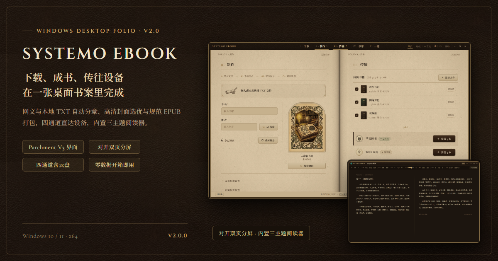

> **Project Guide (HTML Blog): [https://systemsssx.github.io/systemo-ebook/](https://systemsssx.github.io/systemo-ebook/)**
>
> **[简体中文](README.md) | [English](README_EN.md) | [Download Release](https://github.com/systemsssx/systemo-ebook/releases/tag/v2.0.0) | [Changelog](CHANGELOG.md)**

# systemo ebook

A local Windows desktop tool for finding web novels, formatting TXT files into EPUBs, transferring books to e-readers or phones, and reading locally.

[](https://github.com/systemsssx/systemo-ebook/releases)
[](https://github.com/systemsssx/systemo-ebook/releases/tag/v2.0.0)
[](https://systemsssx.github.io/systemo-ebook/)
[](https://github.com/systemsssx/systemo-ebook/stargazers)



**Positioning:** Turn web novels and local TXT files into standard EPUBs with chapters and covers, then send them to your phone, Kindle, or tablet—entirely on your own computer to avoid juggling separate scripts and tools.

---

## How a Book Moves Through the App

`Find or Import TXT` → `Split Chapters & Fetch Cover` → `Build EPUB` → `Send to Device` → `Store & Read Locally`

- **Find or import**: Search by title (or `Title@Author`) across multiple web novel and light novel sources, pick from aggregated recommendation lists, or drop a local TXT file into the window.
- **Chapters and covers**: Split chapters automatically with manual editing and preview; look up author metadata and cover candidates, pick the highest-resolution copy of the same cover art, and upscale it with a bundled local model.
- **Build EPUB**: Pack body text, table of contents, metadata, and cover into a standard EPUB, then clear the temporary download folder automatically.
- **Send to device**: Choose whichever channel suits your device—local cloud drive folder sync, LAN WiFi browser transfer, Amazon Send to Kindle, or Baidu Netdisk relay for Apple Books.
- **Library and reading**: Keep generated books in a persistent local library (retained even if you switch export folders) and double-click any entry to read it in the built-in viewer.

---

## How Each Part Works

### Downloading, Chapter Splitting, and Covers
- **Source routing**: Supports both fast general sources and proofread sources; light novel charts support pagination and inline volume selection on each card, and active downloads can be cancelled anytime.
- **Editable TXT splitting**: When a local TXT file has irregular chapter headings, you can inspect the parsed list and add, delete, or rename chapters before packaging.
- **Cover selection and local upscaling**: Compares identical cover images across sources to pick the sharper original, then runs a local offline upscaler without paid external APIs.

### Sending Books to Phones, Tablets, and Kindles
- **Local cloud folder**: Detects local iCloud Drive, OneDrive, or Google Drive sync folders on your PC and writes EPUBs into an `EasyPub` subfolder for background syncing.
- **LAN WiFi transfer**: Connects your PC and mobile browser on the same WiFi network to receive books directly, with automatic background browser driver updates.
- **Send to Kindle**: Uses Amazon's official web uploader; session state stays in a local app partition without storing passwords.
- **Baidu Netdisk relay**: Launches an isolated native Chrome or Edge session for Baidu authorization when sending to Apple Books, avoiding embedded-window blocks.

### Library, Reader, and Workspace
- **Persistent library**: Keeps book history across export directory changes, displays embedded EPUB covers in the send queue, and supports batch send, export, or removal.
- **Built-in reader**: Powered by `foliate-js` with TOC navigation, bookmarks, full-text search, typography controls, page-flip or scroll modes, and three palettes (Parchment, Ivory, Night).
- **Layout options**: Runs as a single focused view by default; on wider screens, drag any top tab to open a side-by-side dual-page split, or toggle plain paper mode and Chinese/English UI.

---

## Screenshots

| Download & Multi-Source Search | TXT Splitting & Cover Preview |
| :---: | :---: |
|  |  |
| **Four Delivery Channels & Queue** | **Local Library** |
|  |  |
| **Draggable Dual-Page Split** | **Continuous Pipeline View** |
|  |  |
| **Built-in Reader (Parchment)** | **Built-in Reader (Night)** |
|  |  |

---

## Privacy and Usage Boundaries

- **Local execution**: Text cleanup, chapter splitting, cover upscaling, and library management run on your own PC; public source and release archives contain zero user settings, library records, cookies, or proxy credentials.
- **Accounts and network**: Kindle requires your own Amazon sign-in, Baidu relay authorizes in your local browser, and WiFi transfer requires the same LAN. If you prefer not to link Baidu Netdisk, use local cloud folder sync or WiFi transfer.
- **Built-in proxy note**: The proxy core stays off by default and yields to any existing system proxy. Public builds include no private subscription URL; set `EASYPUB_PROXY_SUB_URL` or use your system proxy if needed.

---

## Getting Started

### Portable Full Package (Windows 10 / 11 x64)
1. Download `systemo-ebook-v2.0.0-full.rar` from [Releases](https://github.com/systemsssx/systemo-ebook/releases/tag/v2.0.0) (`275,575,368` bytes / `262.8 MiB`; unpacks to `335` files / `901.3 MB`).
2. Extract to a writable folder (e.g. `D:\systemo-ebook`, not `C:\Program Files`) and keep the entire folder intact.
3. Launch `EasyPub.exe`; backend runtime, Pandoc, fonts, and the local upscaler are bundled, and an empty library on first launch is expected.

SHA256: `A687ECB5E659A6088B92398E33895B9CD0899F8E1666DF5A7E65D4AB9D69272A`

### Running from Source & Custom Book Sources
Requires Windows 10 / 11 x64, Node.js 18+, Python 3.11+, and Electron 27:

```powershell
pip install -r requirements.txt
npm install
npm start
```

- Source and chart logic live in `novelmeta/` (metadata and covers), `novel_dl.py` (novel downloads), `rank_pool.py` (recommendations), and `linovelib.py` (light novel volumes).
- Run `npm run bump` after modifying CSS/JS assets; large runtime binaries (`fonts/`, `models/`, `pandoc-3.10.2/`, `chromedriver.exe`, `tools/mihomo/`) ship in the Release archive rather than Git.

### Current Release Note
Only the full edition is maintained, currently at **v2.0.0** (2026-11-23): switched to the Parchment V3 UI with draggable dual-page split view, added local cloud drive sync as the fourth transfer channel, moved Baidu auth to an isolated native Chrome/Edge session with auto-updating drivers for WiFi and cover fallback, and added multi-source same-art cover resolution selection. See [CHANGELOG.md](CHANGELOG.md) for full history.

---

## Disclaimer & Credits

This is a non-commercial personal project built strictly for programming study and personal offline reading convenience—no ads, no paid courses, and no monetization. Its download and formatting features automate personal offline caching and EPUB typesetting for eye-friendly devices, not piracy distribution. Please respect copyright, use generated files strictly for personal offline reading, and support authors on official platforms.

Built with [Electron](https://www.electronjs.org/), [foliate-js](https://github.com/johnfactotum/foliate-js), [@readium/css](https://github.com/readium/css), [Pandoc](https://pandoc.org/), [OpenCC](https://github.com/BYVoid/OpenCC), and [PyInstaller](https://pyinstaller.org/). **All rights reserved.**
