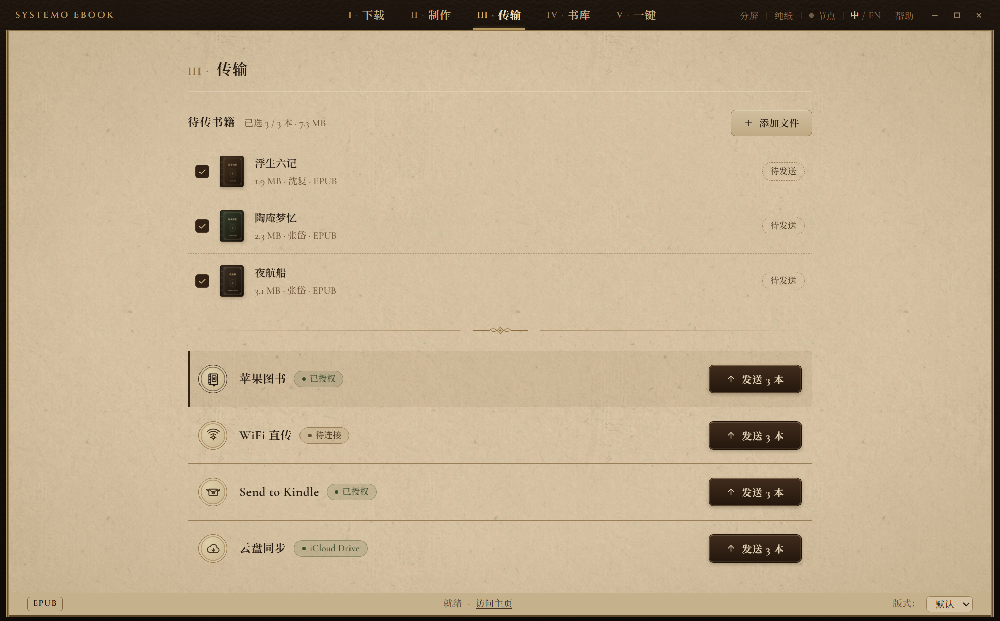
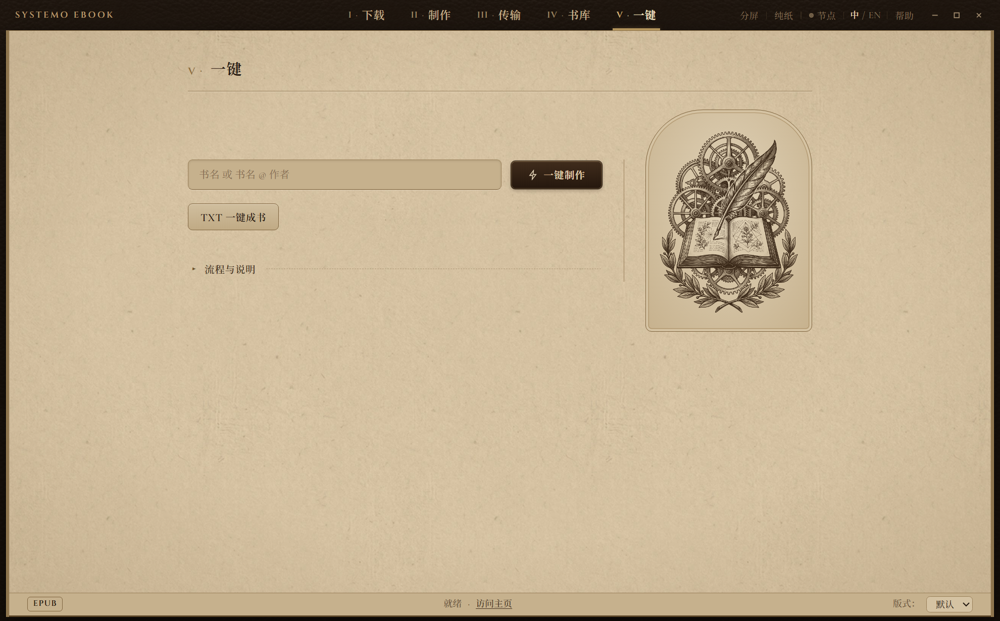
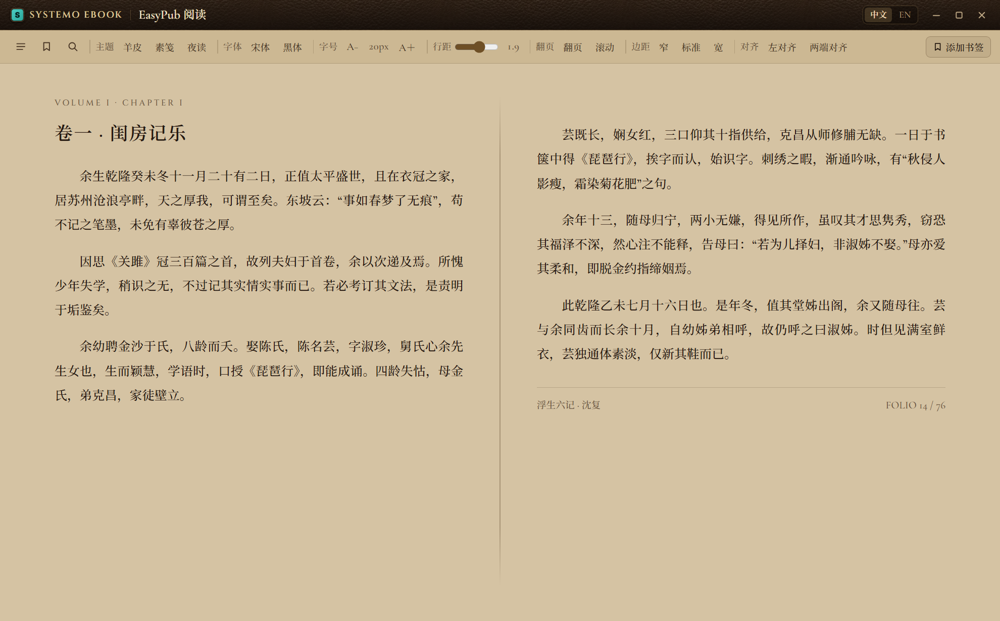
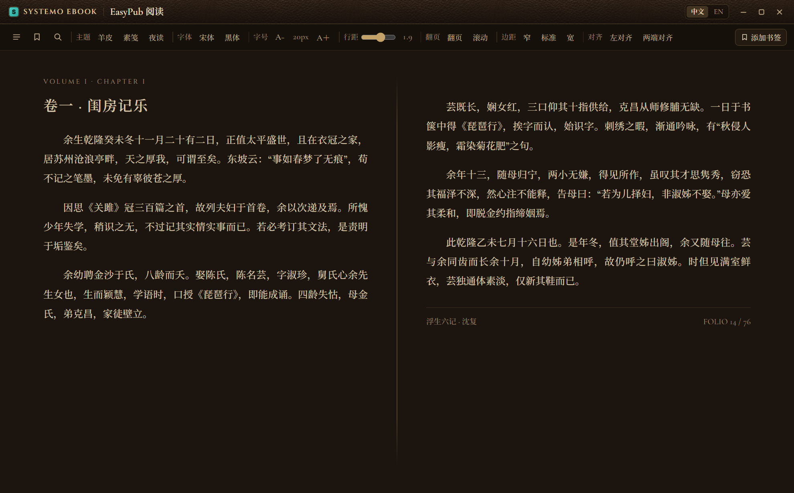

> **Interactive Project Guide (HTML Blog): [https://systemsssx.github.io/systemo-ebook/](https://systemsssx.github.io/systemo-ebook/)**
>
> **[简体中文](README.md) | [English](README_EN.md) | [Download Full Package](https://github.com/systemsssx/systemo-ebook/releases/tag/v2.0.0) | [Changelog](CHANGELOG.md)**

# systemo ebook

**Local Windows E-Book Workbench — One Integrated Pipeline for Finding, Building, Transferring, and Reading EPUBs**

[](https://github.com/systemsssx/systemo-ebook/releases)
[](https://github.com/systemsssx/systemo-ebook/releases/tag/v2.0.0)
[](https://systemsssx.github.io/systemo-ebook/)
[](https://github.com/systemsssx/systemo-ebook/stargazers)


Turning web novels or local TXT files into readable e-books usually takes three or four separate tools: checking encodings, writing regex to split chapters, hunting down clear cover art, packing the EPUB, and dealing with cables or web drives just to move files onto a phone or Kindle.

**Project Positioning:** Turn web novels and local TXT files into standard EPUBs with high-resolution covers and clean tables of contents, then deliver them straight to your phone, Kindle, or tablet—entirely on your local machine, cutting out repetitive formatting and cross-device friction.

---

## 1. The 5-Step Local Loop

`01 Find & Import` → `02 Chapters & HD Cover` → `03 Pack Standard EPUB` → `04 Four-Channel Delivery` → `05 Library & Reader`

1. **01 Find & Import**: Search web novels and light novel volumes across multiple sources by title (or `Title@Author`), browse aggregated charts (14 picks per batch across four platforms), or drag in local TXT files.
2. **02 Smart Chapters & HD Covers**: Automatically split chapters by volume/chapter rules with manual editing and live preview; fetch multi-source covers, choose the highest-resolution match of the same artwork, and upscale it offline via a built-in local model.
3. **03 Standard EPUB Packaging**: Pack body text, table of contents, metadata, and enhanced cover art into a clean EPUB, then automatically clear temporary download folders.
4. **04 Four-Channel Delivery**: Pick the path that fits your device—local cloud folder sync (iCloud / OneDrive / Google Drive), local WiFi browser transfer, official Amazon Send to Kindle, or Apple Books via Baidu Netdisk relay.
5. **05 Persistent Library & Built-in Reader**: Archive books into a persistent cross-directory library for batch delivery or export; double-click to open the built-in two-column reader with Parchment, Ivory, and Night themes.

---

## 2. How It Works: Three Core Pillars

### 1. Acquisition & Typesetting
- **Multi-Source Download & Curated Routing**: Combines fast general sources with proofread sources; light novels support 5 paginated charts with inline volume selection on each card, transparent progress, and instant cancellation.
- **Controllable TXT Chapter Splitting**: Detects common volume and chapter structures automatically while providing an editable chapter list and live split preview.
- **Same-Art HD Selection & Local Super-Resolution**: Compares candidate covers across sources to select the sharpest original, then enhances it offline without paid cloud APIs.

### 2. Four-Channel Device Delivery
- **Local Cloud Drive Sync (Recommended for Apple & Multi-Device)**: Auto-detects local iCloud Drive, OneDrive, or Google Drive sync folders and writes directly to an `EasyPub` subfolder for seamless background sync.
- **Local WiFi Transfer (No App Required)**: Links your desktop and mobile browser over the same LAN for direct file pickup, with automatic background browser driver updates.
- **Send to Kindle & Apple Books Relay**: Uses Amazon's official web channel (session stored only in a local partition) and launches an isolated local Chrome / Edge session for Baidu Netdisk authorization.

### 3. Library, Reader & Workbench
- **Cross-Directory Persistent Library**: Preserves book history even after switching export folders, displays embedded EPUB covers in the transfer queue, and supports batch operations.
- **Three-Theme Two-Column Reader**: Powered by `foliate-js` with TOC navigation, bookmarks, full-text search, customizable typography, page-flip or scroll modes, and Parchment, Ivory, and Night themes.
- **Single-Page Focus & Drag-to-Split Dual View**: Works cleanly as a single page or drags into a side-by-side dual-page folio on wide screens, with one-click Clean Paper mode and bilingual UI switching.

---

## 3. Manual Workflow vs. systemo ebook

| Scenario | Traditional Manual Workflow | With systemo ebook |
| :--- | :--- | :--- |
| **From raw text to readable EPUB** | Search text, fix encoding, write chapter regex, and open separate tools to resize covers and edit metadata. | Search or drop a TXT in one window, auto-split chapters, pick and upscale the best cover offline, and pack a clean EPUB in one click. |
| **Sending books to phone, iPad, or Kindle** | Plug in USB cables, email attachments, or upload to web drives manually—repeating a different ritual per device. | Pick from four local delivery channels: cloud folder auto-sync, local WiFi browser transfer, official Send to Kindle, or Baidu relay. |
| **Managing and previewing a growing library** | Folders fill up with messy TXT files and leftover cache; previewing requires installing a separate reader. | Books archive automatically while temp folders self-clean; browse embedded covers and double-click to read in the built-in reader. |

---

## 4. Screenshots

| I · Multi-Source Download | II · Chapter Split & Cover Preview |
| :---: | :---: |
|  |  |
| **III · 4-Channel Delivery (with Cloud Sync)** | **IV · Persistent Gilt-Spine Library** |
|  |  |
| **Draggable Dual-Page Split Folio** | **V · One-Click Pipeline** |
|  |  |
| **Built-in Reader · Parchment Theme** | **Built-in Reader · Walnut Night Theme** |
|  |  |

---

## 5. Four Engineering & Privacy Principles

- **01 100% Local Processing**: Text parsing, chapter splitting, cover upscaling, and library management all run on your own PC; public packages ship with zero personal data.
- **02 No Single-Channel Lock-In**: All four transfer paths work independently; use local cloud folder sync or WiFi LAN transfer whenever you prefer not to link Baidu Netdisk.
- **03 Offline-Ready Out of the Box**: The portable full package bundles the backend engine, Pandoc, fonts, and local super-resolution model—no Python setup or API keys required.
- **04 Open Source & Extensible Rules**: Proxy cores stay off by default with no private subscriptions bundled; developers can freely extend book sources and ranking parsers.

---

## 6. Getting Started

### 1. Portable Full Package (Recommended)
Download `systemo-ebook-v2.0.0-full.rar` from [GitHub Releases](https://github.com/systemsssx/systemo-ebook/releases/tag/v2.0.0) (`275,575,368` bytes / `262.8 MiB`; unpacks to `335` files / `901.3 MB`; SHA256: `A687ECB5E659A6088B92398E33895B9CD0899F8E1666DF5A7E65D4AB9D69272A`). Extract to a writable folder (e.g. `D:\systemo-ebook`, not `C:\Program Files`), keep the full directory intact, and double-click `EasyPub.exe`.

### 2. Run from Source & Extend Book Sources
Requirements: Windows 10 / 11 (x64), Node.js 18+, Python 3.11+, Electron 27.

```powershell
pip install -r requirements.txt
npm install
npm start
```

- Customize book sources in the root Python modules: `novelmeta/` (metadata & covers), `novel_dl.py` (multi-source downloading), `rank_pool.py` (aggregated rankings), and `linovelib.py` (light novel volume parsing). Run `npm run bump` after editing CSS/JS assets.
- Public source and release packages contain no private proxy subscription; use your system proxy or set `EASYPUB_PROXY_SUB_URL`.

### 3. Current Release Note
Current release is **v2.0.0** (2026-11-23, unified full edition): redesigned 18th-century Parchment V3 workspace with drag-to-split dual-page view; added Channel 4 local cloud folder sync; switched Baidu Netdisk auth to an isolated local Chrome / Edge session with auto-updating browser drivers for WiFi and cover channels; upgraded cover lookup to multi-source same-art HD selection. See [CHANGELOG.md](CHANGELOG.md) for full history.

---

## 7. Disclaimer & Credits

This is a non-commercial personal project built strictly for programming study and personal offline reading convenience—no ads, no paid courses, and no monetization. Its download and formatting features automate personal offline caching and EPUB typesetting for eye-friendly devices, not piracy distribution. Please respect copyright, use generated files strictly for personal offline reading, and support authors on official platforms.

Built with [Electron](https://www.electronjs.org/), [foliate-js](https://github.com/johnfactotum/foliate-js), [@readium/css](https://github.com/readium/css), [Pandoc](https://pandoc.org/), [OpenCC](https://github.com/BYVoid/OpenCC), and [PyInstaller](https://pyinstaller.org/). **All rights reserved.**
